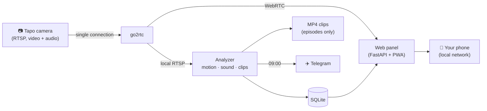

<div align="center">

<sub>**English** · [Español](README.es.md)</sub>


# Tapoli

**Baby sleep tracking with a Tapo camera, 100% local.**

How many times your baby woke up, how long they slept and how restless the night was —
on your phone every morning. No cloud, no subscription, and no video ever leaves your home.


<sub>Screenshots use made-up demo data. The app interface is currently in Spanish.</sub>

</div>

---

## ✨ Features

| | |
|---|---|
| 🌙 **Waking ≠ moving** | Actigraphy-style algorithm: rolling over in their sleep counts as *restlessness*; sustained activity or crying counts as *waking up*. |
| 🛏️ **Empty-crib detection** | If you take the baby out of the crib, that time isn't counted as sleep (total stillness right after an adult is seen). |
| 📈 **Sleep diary and trends** | One row per night on the same time scale: schedules, regularity, how long it takes to fall asleep. |
| 🎬 **Short clips to review** | Only a few seconds of each movement are kept, and you're only asked about the **uncertain** ones. |
| 🎯 **Calibrates with your labels** | Tries hundreds of threshold combinations and suggests the most accurate one — never applied without your OK. |
| 📺 **Real-time live view** | WebRTC with < 1 s latency and audio, over the same camera connection used for analysis. |
| 📝 **Notes per night** | Teething, vaccines, naps… to see what makes a difference. |
| ✈️ **Telegram summary** | Every morning, to every phone you link from the app. |
| 📱 **iPhone web app** | Add it to your home screen and it works like a native app. Light and dark mode. |
| 🔒 **Private** | Everything runs on your own server/NAS. The panel only answers on your local network. |

<table>
<tr>
<td></td>
<td></td>
<td></td>
<td></td>
</tr>
<tr align="center"><td>Home</td><td>Trends</td><td>Night & notes</td><td>Light mode</td></tr>
</table>

## 🧩 How it works



- **One camera connection**: go2rtc opens it and shares it. The official Tapo app keeps working.
- **Motion**: frame differencing at low resolution (3 fps, grayscale), only inside the **crib zone** you draw in the app. Infrared grain and sudden lighting changes are ignored.
- **Sound**: level plus simple voice/crying detection (sustained energy in the 300–3000 Hz band above the background noise).
- **Waking up**: a minute is *active* with ≥ K seconds of motion. A wake-up starts when there are ≥ **X** active minutes within a **Y**-minute window, or activity plus crying; it ends after **Z** minutes of calm; wake-ups less than **N** minutes apart are merged. Every threshold is configurable and can be calibrated.
- **Self-adjusting zone**: if the camera gets moved, Tapoli compares image edges against a reference and shifts the crib zone automatically.
- **Lightweight**: built for a modest NAS (tested on an Intel Celeron J4025): about 5% of one CPU core.

## 🚀 Getting started

**You need:** a Tapo camera with RTSP (C200, C210, C100…), a machine running Docker on the same network (a Synology NAS works) and 5 minutes.

1. **Create a camera account** in the Tapo app: *camera → Settings → Advanced settings → Camera account*.
2. **Clone and configure:**
   ```bash
   git clone https://github.com/goxka/tapoli.git && cd tapoli
   cp .env.example .env      # fill in the camera IP, user and password, and your server's IP
   ```
3. **Start it:**
   ```bash
   docker compose up -d --build
   ```
4. Open **`http://SERVER-IP:8095`** on your phone → *Ajustes → Zona de la cuna* (Settings → Crib zone) and draw the inside of the crib.
5. On iPhone: *Share → Add to Home Screen*.

> **Synology / "bridge" networks with no outbound route**: Tapoli uses `network_mode: host` and builds the image with `network: host`, so it also works on NAS setups where Docker's bridge network can't reach the camera.

### Configuration

- **`.env`** — camera, server IP, user (PUID/PGID), time zone and Telegram bot token. Never committed to the repository.
- **`config/config.yaml`** — every threshold, commented line by line (comments in Spanish). It's created automatically on first run from [`app/tapoli/config.default.yaml`](app/tapoli/config.default.yaml) and hot-reloaded. Most settings can be changed from the app (*Ajustes*).

### Telegram (optional)

Create a bot with [@BotFather](https://t.me/BotFather), put its token in `TELEGRAM_BOT_TOKEN`, and link your phone from *Ajustes → Resumen por Telegram*. Linking uses a one-time code.

## 🎯 Labeling and calibration

1. **Revisar** (Review) only shows the uncertain clips. Mark them *Dormida* (asleep — even if they moved), *Despierta* (awake), *Falsa alarma* (false alarm) or *No lo sé* (not sure).
2. Your labels **override** the algorithm in that night's summary.
3. With around 30 labels, *Ajustes → Calibración* searches for the best combination of X, Y, Z, N and sensitivity, shows its precision and recall, and only applies it if you confirm. A history lets you roll back.

## 🔒 Privacy

- Nothing leaves your network except the Telegram summary, if you enable it.
- The panel rejects connections that don't come from a private network. **Don't expose port 8095 on your router**; use a VPN to check it from outside your home.
- There's no continuous recording: only short clips of each movement, deleted after 14 days unless you label them.

## 🛠️ Development

```
app/tapoli/
  runner.py      analyzer (capture, metrics, clips, nights, Telegram)
  capture.py     RTSP connection with reconnection and backoff
  motion.py      motion detector                   audio.py   sound level and voice/crying
  analysis.py    wake-up algorithm, nights, calibration
  align.py       automatic crib-zone adjustment    clips.py   ring buffer and clips
  web.py         API and panel (FastAPI)           static/    web app (no dependencies)
tools/
  deploy.sh      deploy via Portainer + verification   verify.py  post-deploy test suite
```

## 📄 License

[MIT](LICENSE). Includes `video-rtc.js` from [go2rtc](https://github.com/AlexxIT/go2rtc) (MIT, © Alexey Khit).

<sub>Tapoli is not affiliated with TP-Link. It is not a medical device: it's a tool to better understand your baby's nights, not to monitor anyone's health.</sub>
