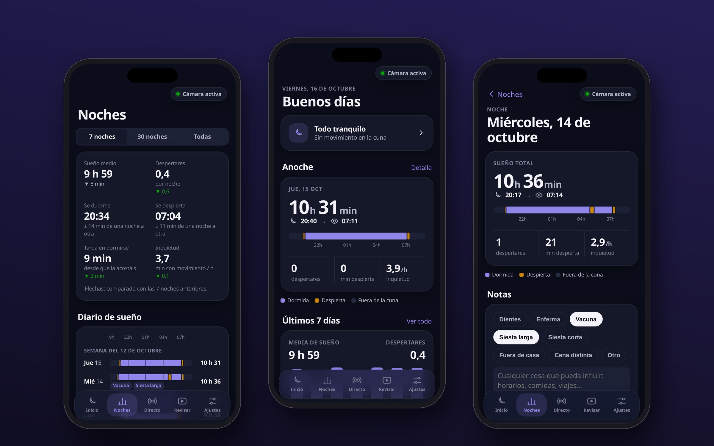
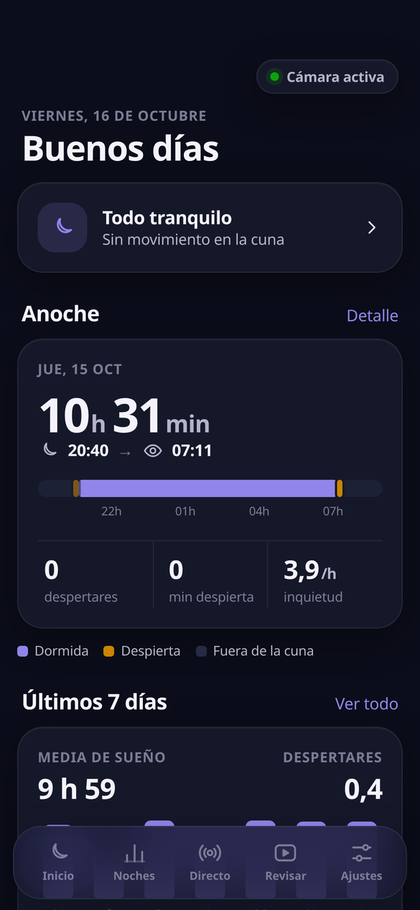
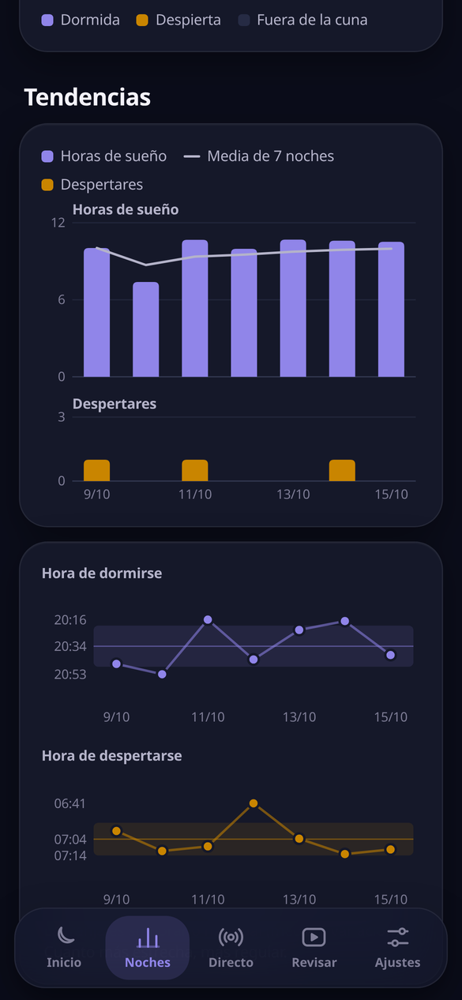
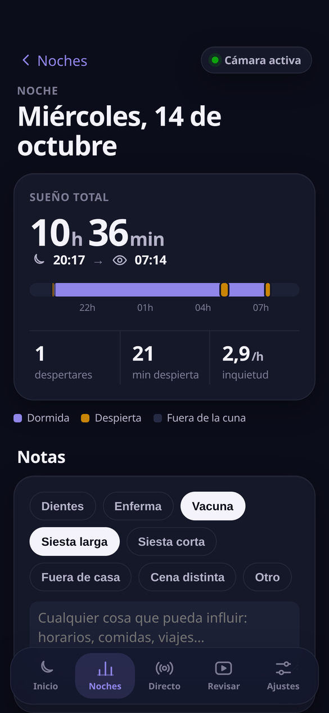
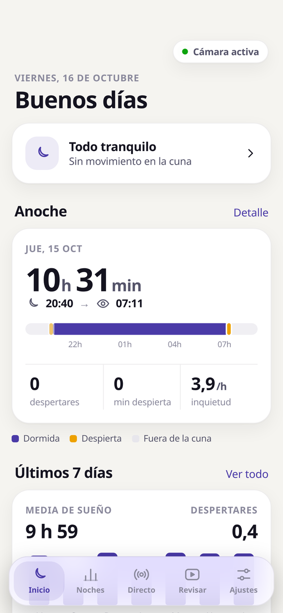
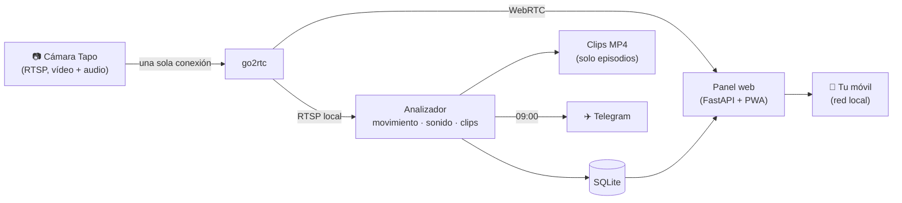

<div align="center">


# Tapoli

**Análisis del sueño de tu bebé con una cámara Tapo, 100 % en local.**

Cuántas veces se ha despertado, cuánto ha dormido y cómo de inquieta ha estado,
cada mañana en tu móvil — sin nube, sin suscripciones y sin que ningún vídeo salga de casa.




<sub>Capturas con datos de demostración inventados.</sub>

</div>

---

## ✨ Qué hace

| | |
|---|---|
| 🌙 **Despertar ≠ moverse** | Algoritmo tipo actigrafía: girarse dormida es *inquietud*; actividad sostenida o llanto es *despertar*. |
| 🛏️ **Detecta la cuna vacía** | Si la sacáis de la cuna, ese rato no cuenta como sueño (quietud total tras ver a un adulto). |
| 📈 **Diario de sueño y tendencias** | Una fila por noche en la misma escala horaria: horarios, regularidad, cuánto tarda en dormirse. |
| 🎬 **Clips cortos para revisar** | Solo guarda unos segundos de cada movimiento y solo te pregunta por los **dudosos**. |
| 🎯 **Se calibra con tus etiquetas** | Prueba cientos de combinaciones de umbrales y te propone la que más acierta (nunca sin tu permiso). |
| 📺 **Directo en tiempo real** | WebRTC con < 1 s de retraso y sonido, usando la misma conexión que el análisis. |
| 📝 **Notas por noche** | Dientes, vacunas, siestas… para ver qué influye. |
| ✈️ **Resumen por Telegram** | Cada mañana, a todos los móviles que vincules desde la app. |
| 📱 **Web app para iPhone** | Se añade a la pantalla de inicio y funciona como una app. Modo claro y oscuro. |
| 🔒 **Privado** | Todo corre en tu servidor/NAS. El panel solo responde a la red local. |

<table>
<tr>
<td></td>
<td></td>
<td></td>
<td></td>
</tr>
<tr align="center"><td>Inicio</td><td>Tendencias</td><td>Noche y notas</td><td>Modo claro</td></tr>
</table>

## 🧩 Cómo funciona



- **Una sola conexión a la cámara**: go2rtc la abre y la reparte. La app oficial de Tapo sigue funcionando.
- **Movimiento**: diferencia entre fotogramas en baja resolución (3 fps, escala de grises), solo dentro de la **zona de la cuna** que dibujas en la app. Ignora el grano del infrarrojo y los cambios bruscos de luz.
- **Sonido**: nivel y detección sencilla de voz/llanto (energía sostenida en 300–3000 Hz sobre el ruido de fondo).
- **Despertar**: un minuto es *activo* con ≥ K segundos de movimiento. Hay despertar si en una ventana de **Y** min hay ≥ **X** minutos activos, o actividad + llanto; termina tras **Z** min de calma; se fusionan si los separan < **N** min. Todos los umbrales son configurables y calibrables.
- **Zona autoajustable**: si mueves la cámara, compara los bordes de la imagen con una referencia y desplaza la zona sola.
- **Ligero**: pensado para un NAS modesto (probado en un Intel Celeron J4025): ~5 % de un núcleo.

## 🚀 Puesta en marcha

**Necesitas:** una cámara Tapo con RTSP (C200, C210, C100…), un equipo con Docker en la misma red (un NAS Synology vale) y 5 minutos.

1. **Crea una cuenta de cámara** en la app Tapo: *cámara → Ajustes → Ajustes avanzados → Cuenta de la cámara*.
2. **Clona y configura:**
   ```bash
   git clone https://github.com/goxka/tapoli.git && cd tapoli
   cp .env.example .env      # rellena IP, usuario y contraseña de la cámara e IP del servidor
   ```
3. **Arranca:**
   ```bash
   docker compose up -d --build
   ```
4. Abre **`http://IP-DEL-SERVIDOR:8095`** en el móvil → *Ajustes → Zona de la cuna* y dibuja el interior de la cuna.
5. En iPhone: *Compartir → Añadir a pantalla de inicio*.

> **Nota Synology / redes "bridge" sin salida**: Tapoli usa `network_mode: host` y la imagen se construye con `network: host`, así funciona también en NAS donde la red bridge de Docker no llega a la cámara.

### Configuración

- **`.env`** — cámara, IP del servidor, usuario (PUID/PGID), zona horaria y token del bot de Telegram. Nunca se sube al repositorio.
- **`config/config.yaml`** — todos los umbrales, comentados línea a línea. Se crea solo la primera vez a partir de [`app/tapoli/config.default.yaml`](app/tapoli/config.default.yaml) y se recarga en caliente. La mayoría se cambian desde la app (*Ajustes*).

### Telegram (opcional)

Crea un bot con [@BotFather](https://t.me/BotFather), pon el token en `TELEGRAM_BOT_TOKEN` y vincula tu móvil desde *Ajustes → Resumen por Telegram*. La vinculación usa un código de un solo uso.

## 🎯 Etiquetar y calibrar

1. En **Revisar** aparecen solo los clips dudosos. Marca *Dormida* (aunque se moviera), *Despierta*, *Falsa alarma* o *No lo sé*.
2. Tus etiquetas **mandan** sobre el algoritmo en el resumen de esa noche.
3. Con ~30 etiquetas, *Ajustes → Calibración* busca la mejor combinación de X, Y, Z, N y sensibilidad, te enseña precisión y sensibilidad, y solo la aplica si confirmas. Hay historial para volver atrás.

## 🔒 Privacidad

- Nada sale de tu red salvo el resumen de Telegram, si lo activas.
- El panel rechaza conexiones que no vengan de una red privada. **No abras el puerto 8095 en el router**; para verlo fuera de casa usa una VPN.
- No se graba vídeo continuo: solo clips cortos de cada movimiento, que se borran a los 14 días si no los etiquetas.

## 🛠️ Desarrollo

```
app/tapoli/
  runner.py      analizador (captura, métricas, clips, noches, Telegram)
  capture.py     conexión RTSP con reconexión y espera creciente
  motion.py      detector de movimiento          audio.py   nivel y voz/llanto
  analysis.py    algoritmo de despertar, noches, calibración
  align.py       reajuste automático de la zona   clips.py   búfer circular y clips
  web.py         API y panel (FastAPI)            static/    web app (sin dependencias)
tools/
  deploy.sh      publicación vía Portainer + verificación   verify.py  batería de pruebas
```

## 📄 Licencia

[MIT](LICENSE). Incluye `video-rtc.js` de [go2rtc](https://github.com/AlexxIT/go2rtc) (MIT, © Alexey Khit).

<sub>Tapoli no está afiliado a TP-Link. No es un dispositivo médico: es una herramienta para conocer mejor las noches, no para vigilar la salud de nadie.</sub>
